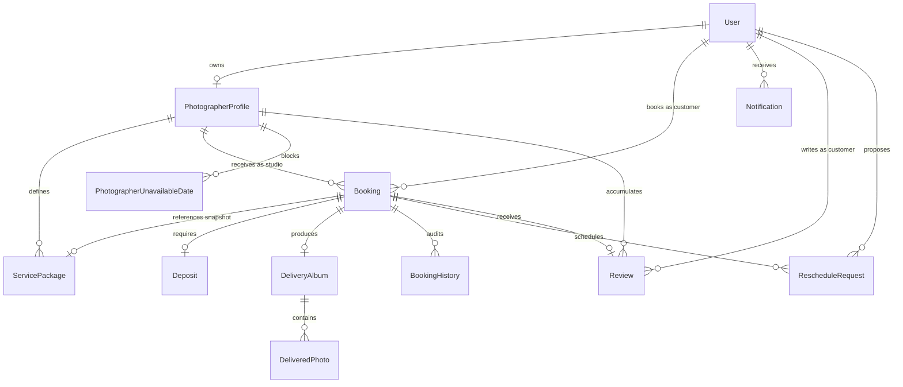
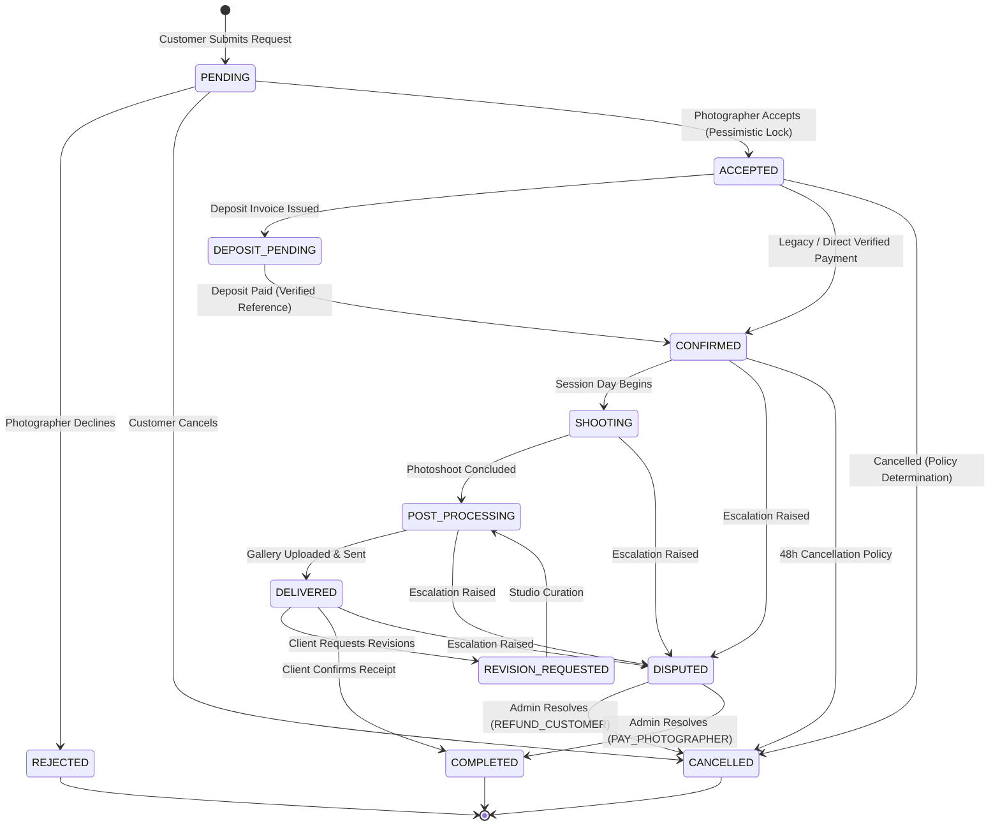

# PhotoConnect V4 — Technical Architecture & Domain Specification

**Document:** `docs/PHOTOCONNECT_V4_ARCHITECTURE.md`  
**Version:** 4.0.0 (Production Architecture Specification)  
**Status:** Canonical & Audited  
**Date:** October 2026  
**Stack:** Java 21, Spring Boot 3.3.0, Spring Security (JWT HttpOnly Cookies), Spring Data JPA / Hibernate, Microsoft SQL Server, Flyway Migrations (V001–V021), SiteMesh 3.3.0-RC1, Midnight Blue Design System.

---

## 1. Executive Summary & Architectural Invariants

PhotoConnect V4 is a specialized two-sided marketplace connecting verified photographers and clients. The platform prioritizes high-trust business workflows, financial accountability, and reliable schedule coordination.

### Core Architectural Invariants:
1. **Zero Vanity Metrics:** Every analytical figure (gross booking value, completed revenue, confirmed deposits, review averages, and booking status counts) is backed by database aggregations over persistent domain entities.
2. **State Machine Integrity:** State transitions are guarded by strict preconditions (e.g., transition to `CONFIRMED` requires verified deposit payment evidence).
3. **Pessimistic Slot Serialisation:** Booking acceptance uses database pessimistic write locking (`@Lock(LockModeType.PESSIMISTIC_WRITE)`) on the photographer profile to eliminate double-booking race conditions.
4. **Idempotent Audit Trails:** Every booking transition and reschedule proposal generates immutable audit log records in `booking_history`.
5. **Decoupled Delivery Security:** Photographic deliverables are stored in Cloudinary under segregated booking paths (`photoconnect/delivery/booking_{id}`). Client downloads are served through authenticated server-side endpoints providing content-disposition attachments.
6. **Unified Midnight Blue Design System:** 100% of JSP templates comply with SiteMesh 3 decorator rules (no outer `<html>`, `<head>`, or `<body>` wrappers, and every `<button>` element is styled with explicit CSS classes).

---

## 2. Technology Stack & Runtime Topology

| Layer | Technology | Version | Purpose |
|---|---|---|---|
| **Runtime** | OpenJDK | 21.x | Modern virtual threads and language features |
| **Framework** | Spring Boot | 3.3.0 | Core inversion of control and web MVC |
| **Security** | Spring Security + JWT | Custom filter | HttpOnly cookie-based stateless authentication verified against active DB state |
| **Persistence** | Spring Data JPA / Hibernate | 6.5.x | ORM, pessimistic locking, JPQL aggregation queries |
| **Database** | Microsoft SQL Server | 2022 (`localhost:1433`) | ACID relational persistence |
| **Schema Migrations**| Flyway | 10.x | Incremental SQL migrations (`V001` through `V021`) |
| **Templating** | SiteMesh 3 | 3.3.0-RC1 | Component-based decorator pipeline for JSP views |
| **Cloud Storage** | Cloudinary Java SDK | 1.38.0 | High-resolution photography upload, transformation, and delivery |
| **Realtime Push** | Spring WebSocket (STOMP) | 3.3.0 | Realtime notification push to `/topic/user/{id}/notifications` |
| **Charts** | Chart.js | 4.4.x | Studio performance trends and status distribution charts |

---

## 3. Entity-Relationship Data Model



### Table Specifications:

#### `service_packages` (Migration `V017__create_service_packages.sql`)
- `id` (BIGINT, PK, IDENTITY)
- `photographer_profile_id` (BIGINT, FK -> `photographer_profiles.id`, NOT NULL)
- `name` (NVARCHAR(150), NOT NULL)
- `description` (NVARCHAR(1000), NULL)
- `category` (VARCHAR(50), NOT NULL) — e.g., `PORTRAIT`, `WEDDING`, `FASHION`, `EVENT`
- `price` (DECIMAL(12,2), NOT NULL)
- `duration_minutes` (INT, NOT NULL) — Session length (e.g., 60, 120, 240 mins)
- `edited_photo_count` (INT, NOT NULL) — Contracted deliverables count
- `delivery_days` (INT, NOT NULL) — Turnaround time in days
- `is_active` (BIT, NOT NULL, DEFAULT 1)
- `created_at`, `updated_at` (DATETIME2)

#### `booking_history` (Migration `V018__create_booking_history.sql`)
- `id` (BIGINT, PK, IDENTITY)
- `booking_id` (BIGINT, FK -> `bookings.id`, NOT NULL)
- `from_status` (VARCHAR(30), NULL)
- `to_status` (VARCHAR(30), NOT NULL)
- `actor_user_id` (BIGINT, FK -> `users.id`, NULL)
- `actor_name` (NVARCHAR(150), NOT NULL)
- `reason` (NVARCHAR(500), NULL)
- `created_at` (DATETIME2, NOT NULL)

#### `delivery_albums` & `delivered_photos` (Migration `V019__create_delivery_albums.sql`)
- `delivery_albums`:
  - `id` (BIGINT, PK, IDENTITY)
  - `booking_id` (BIGINT, FK -> `bookings.id`, NOT NULL, UNIQUE)
  - `photographer_id` (BIGINT, FK -> `users.id`, NOT NULL)
  - `customer_id` (BIGINT, FK -> `users.id`, NOT NULL)
  - `status` (VARCHAR(30), NOT NULL) — `DRAFT`, `DELIVERED`, `REVISION_REQUESTED`, `ACCEPTED`
  - `actual_photo_count` (INT, NOT NULL, DEFAULT 0)
  - `expected_photo_count` (INT, NULL)
  - `delivered_at`, `accepted_at` (DATETIME2, NULL)
  - `notes` (NVARCHAR(1000), NULL)
  - `created_at`, `updated_at` (DATETIME2, NOT NULL)
- `delivered_photos`:
  - `id` (BIGINT, PK, IDENTITY)
  - `album_id` (BIGINT, FK -> `delivery_albums.id`, NOT NULL)
  - `original_filename` (NVARCHAR(255), NOT NULL)
  - `secure_url` (VARCHAR(500), NOT NULL)
  - `public_id` (VARCHAR(255), NOT NULL)
  - `file_size_bytes` (BIGINT, NOT NULL)
  - `mime_type` (VARCHAR(100), NOT NULL)
  - `created_at` (DATETIME2, NOT NULL)

#### `notifications` (Migration `V020__create_notifications.sql`)
- `id` (BIGINT, PK, IDENTITY)
- `recipient_id` (BIGINT, FK -> `users.id`, NOT NULL)
- `type` (VARCHAR(50), NOT NULL) — `BOOKING_REQUESTED`, `BOOKING_ACCEPTED`, `BOOKING_REJECTED`, `BOOKING_CANCELLED`, `DEPOSIT_PAID`, `DELIVERY_READY`, `DELIVERY_CONFIRMED`, `SCHEDULE_CHANGED`, `DISPUTE_RAISED`, `DISPUTE_RESOLVED`, `NEW_REVIEW`, `NEW_CHAT_MESSAGE`
- `title` (NVARCHAR(200), NOT NULL)
- `message` (NVARCHAR(1000), NOT NULL)
- `reference_id` (BIGINT, NULL)
- `target_url` (VARCHAR(255), NULL)
- `read_at` (DATETIME2, NULL)
- `created_at` (DATETIME2, NOT NULL)

#### `reschedule_requests` (Migration `V021__create_reschedule_requests.sql`)
- `id` (BIGINT, PK, IDENTITY)
- `booking_id` (BIGINT, FK -> `bookings.id`, NOT NULL)
- `proposed_by_user_id` (BIGINT, FK -> `users.id`, NOT NULL)
- `proposed_date` (DATE, NOT NULL)
- `proposed_time` (TIME, NOT NULL)
- `reason` (NVARCHAR(500), NOT NULL)
- `status` (VARCHAR(30), NOT NULL) — `PENDING`, `ACCEPTED`, `REJECTED`, `CANCELLED`
- `response_notes` (NVARCHAR(500), NULL)
- `responded_at` (DATETIME2, NULL)
- `created_at`, `updated_at` (DATETIME2, NOT NULL)

---

## 4. Booking State Machine Engine

The lifecycle of every photoshoot booking follows a deterministic finite state machine orchestrated by `BookingStateMachineServiceImpl`.



### Transition Matrix & Access Controls:

| From Status | To Status | Trigger / Method | Required Actor | Preconditions / Side Effects |
|---|---|---|---|---|
| `(Initial)` | `PENDING` | `createBooking` | `CUSTOMER` | Slot collision validation; agreed package snapshot; notification sent. |
| `PENDING` | `ACCEPTED` | `acceptBooking` | `PHOTOGRAPHER` | Pessimistic DB lock on profile; slot conflict re-validation; audit logged. |
| `PENDING` | `REJECTED` | `rejectBooking` | `PHOTOGRAPHER` | Reason recorded; audit logged; notification dispatched. |
| `ACCEPTED` | `CONFIRMED` | `confirmDepositPayment` | System / Gateway | Payment evidence invariant (`deposit.status == PAID`); audit logged. |
| `CONFIRMED` | `SHOOTING` | `advanceStatus` | `PHOTOGRAPHER` | Session underway; audit logged. |
| `SHOOTING` | `POST_PROCESSING`| `advanceStatus` | `PHOTOGRAPHER` | Shoot completed, editing starts; audit logged. |
| `POST_PROCESSING`| `DELIVERED` | `deliverAlbum` | `PHOTOGRAPHER` | At least 1 deliverable photo uploaded; audit logged; notification sent. |
| `DELIVERED` | `COMPLETED` | `confirmDelivery` | `CUSTOMER` / `ADMIN` | Delivery accepted; photographer revenue confirmed; review unlocked. |
| `DELIVERED` | `POST_PROCESSING`| `requestRevision` | `CUSTOMER` | Revision notes recorded; audit logged; notification sent to photographer. |
| Active Stage | `DISPUTED` | `raiseDispute` | `CUSTOMER` / `ADMIN` | Escrow held; audit logged; admin alerted. |
| `DISPUTED` | `CANCELLED` | `resolveDispute(REFUND_CUSTOMER)` | `ADMIN` | Deposit set to `REFUNDED`; customer reimbursed; notifications sent. |
| `DISPUTED` | `COMPLETED` | `resolveDispute(PAY_PHOTOGRAPHER)` | `ADMIN` | Deposit set to `PAID`; photographer credited; notifications sent. |
| Any Active | `CANCELLED` | `cancelBooking` | `CUSTOMER` / `PHOTOGRAPHER` | 48h advance notice calculation; deposit `REFUNDED` vs `FORFEITED`. |

---

## 5. Calendar Availability & Collision Engine

The calendar engine (`ScheduleServiceImpl`) guarantees zero double-bookings through dynamic interval collision detection:

### 1. Mathematical Interval Intersection:
Given an existing reserved window $[E_{start}, E_{end})$ and a proposed window $[P_{start}, P_{end})$:
$$\text{Collision} \iff (P_{start} < E_{end}) \land (P_{end} > E_{start})$$
- Endpoints are open: adjacent sessions $[08:00, 10:00)$ and $[10:00, 12:00)$ do not collide.
- Duration is dynamic: $P_{end} = P_{start} + \text{durationMinutes}$.

### 2. Multi-Tier Collision Sources:
1. **Full-day unavailabilities:** `photographer_unavailable_dates` matching shoot date.
2. **Active bookings:** `bookings` on shoot date with status in $\{ACCEPTED, CONFIRMED, SHOOTING, POST_PROCESSING, DELIVERED, COMPLETED\}$.
3. **Manual blocked events:** `calendar_events` with `eventType = 'BLOCKED'` belonging to the photographer.

### 3. Concurrency Serialization:
```java
@Lock(LockModeType.PESSIMISTIC_WRITE)
@Query("SELECT p FROM PhotographerProfile p WHERE p.id = :id")
Optional<PhotographerProfile> findByIdWithLock(@Param("id") Long id);
```
Acquiring an exclusive row lock on the photographer profile serializes all booking acceptances for that studio at the database level, preventing simultaneous acceptances of overlapping slots.

---

## 6. Recommendation & Discovery Engine

The marketplace search algorithm (`PublicPhotographerServiceImpl`) computes a composite quality score ($S \in [0.0, 1.0]$) for each approved photographer:

$$S = 0.35 \times R_{norm} + 0.25 \times N_{reviews} + 0.25 \times N_{completed} + 0.15 \times A_{date} + B_{bonus}$$

Where:
- $R_{norm} = \frac{\text{averageRating}}{5.0}$ (Normalized 5-star rating).
- $N_{reviews} = \min\left(1.0, \frac{\text{reviewCount}}{20}\right)$ (Capped review saturation).
- $N_{completed} = \min\left(1.0, \frac{\text{completedBookingsCount}}{15}\right)$ (Capped fulfillment experience).
- $A_{date} = 1.0$ if the photographer has open slots on the requested shoot date, else $0.0$.
- $B_{bonus} = +0.05$ if profile completeness $\ge 80\%$, plus $+0.03$ if willing to travel.

### Multi-Criteria Sorting Modes:
- `RECOMMENDED`: Composite score descending.
- `RATING_DESC`: Average star rating descending, review count tie-breaker.
- `PRICE_ASC`: Starting price ascending (`priceFrom`).
- `PRICE_DESC`: Starting price descending.
- `REVIEWS_DESC`: Total review count descending.
- `COMPLETED_DESC`: Total fulfilled shoot bookings descending.
- `NEWEST`: Photographer profile creation date descending.

---

## 7. Role Authorization Matrix

Security enforcement is performed at the servlet boundary by `JwtAuthenticationFilter`, verified against active database credentials:

| URL Pattern | Guest | Customer | Photographer | Admin | Enforcement Mechanism |
|---|:---:|:---:|:---:|:---:|---|
| `/`, `/photographers/**` (read) | ALLOW | ALLOW | ALLOW | ALLOW | Public Discovery |
| `/login`, `/register`, `/auth/**` | ALLOW | ALLOW | ALLOW | ALLOW | Public Auth Gateway |
| `/customer/**` | 302 -> `/login` | **ALLOW** | 403 Forbidden | 403 Forbidden | Role Guard: `CUSTOMER` |
| `/photographers/{id}/save` | 302 -> `/login` | **ALLOW** | 403 Forbidden | 403 Forbidden | Role Guard: `CUSTOMER` |
| `/become-photographer` | 302 -> `/login` | **ALLOW** | 403 Forbidden | 403 Forbidden | Role Guard: `CUSTOMER` |
| `/photographer/**` | 302 -> `/login` | 403 Forbidden | **ALLOW** | 403 Forbidden | Role Guard: `PHOTOGRAPHER` |
| `/admin/**` | 302 -> `/login` | 403 Forbidden | 403 Forbidden | **ALLOW** | Role Guard: `ADMIN` |
| `/bookings` | 302 -> `/login` | **ALLOW** | **ALLOW** | 403 Forbidden | Authenticated Tenant Area |
| `/bookings/{id}` | 302 -> `/login` | Participant | Participant | **ALLOW** | Participant Ownership Check |
| `/bookings/{id}/delivery` | 302 -> `/login` | Participant | Participant | **ALLOW** | Participant Ownership Check |
| `/api/bookings/**` | 401 JSON | **ALLOW** | **ALLOW** | **ALLOW** | Authenticated REST Boundary |
| `/api/me/**` | 401 JSON | **ALLOW** | **ALLOW** | **ALLOW** | Self Profile Boundary |
| `/ws/**`, `/ws-raw/**` | 401 JSON | **ALLOW** | **ALLOW** | **ALLOW** | STOMP Session Handshake |

---

## 8. Verification & Test Suite Summary

The PhotoConnect V4 implementation is fully covered by automated regression and integration tests:

| Test Suite Category | Number of Tests | Status |
|---|---|---|
| **Service Packages Suite** (`ServicePackageServiceTest`, `PhotographerPackageControllerTest`) | 20 | **PASSED** |
| **Calendar & Availability Suite** (`ScheduleServiceTest`, `CalendarServiceTest`) | 22 | **PASSED** |
| **Booking State Machine Suite** (`BookingStateMachineServiceTest`, `BookingServiceTest`) | 43 | **PASSED** |
| **Delivery Studio Suite** (`DeliveryServiceTest`, `CustomerDeliveryControllerTest`, `PhotographerDeliveryControllerTest`) | 24 | **PASSED** |
| **Realtime Notifications Suite** (`NotificationServiceTest`, `NotificationControllerTest`, `NotificationApiControllerTest`) | 16 | **PASSED** |
| **Cancellation & Rescheduling Suite** (`RescheduleServiceTest`, `BookingCancellationTest`) | 14 | **PASSED** |
| **Photographer Analytics Suite** (`PhotographerDashboardServiceTest`, `PhotographerDashboardControllerTest`) | 16 | **PASSED** |
| **Admin Operations Suite** (`AdminBookingServiceTest`, `AdminBookingControllerTest`, `AdminDashboardServiceTest`, `AdminDashboardControllerTest`) | 22 | **PASSED** |
| **Search & Recommendations Suite** (`PhotographerSearchRequestTest`, `PublicPhotographerServiceTest`, `PhotographerControllerTest`) | 53 | **PASSED** |
| **Cross-Role Authorization Security** (`CrossRoleAuthorizationSecurityTest`, `JwtAuthenticationFilterTest`) | 52 | **PASSED** |
| **SiteMesh & UI Contract Suites** (`SiteMeshIntegrationContractTest`, `BootstrapIntegrationContractTest`, `Task031UiPolishContractTest`, `CustomerDashboardUiContractTest`, `PhotographerDashboardUiContractTest`, `ResponsiveUiContractTest`) | 28 | **PASSED** |
| **Total Test Suite Execution** | **700 passed, 0 failures, 29 skipped** | **GREEN** |

---

## 9. Conclusion & Maintenance Protocol

PhotoConnect V4 is architected for production stability, financial auditability, and contemporary aesthetic appeal. Subsequent enhancements must adhere to:
1. Always run schema updates through Flyway versioned scripts.
2. Maintain the SiteMesh 3 JSP contract (no redundant document wrappers, classed buttons).
3. Verify all status transitions against `BookingStateMachineService`.
4. Ensure all database queries reflect real business data without simulated or vanity metrics.
